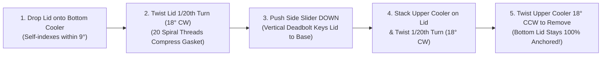

# King of Koolers — Patented 20-Start Spiral Helix & Vertical Deadbolt Locking System
**Engineering Architecture, Kinematics & Product Integration Plan**
*Inventor & Lead Designer: Austin Marshall*

---

## 1. Executive Summary & Core Problem Solved

### The Modular Stacking Paradox
In a multi-tier cylindrical stacking cooler system where **Cooler Tier B** threads onto the top of **Cooler Tier A's Lid**, a critical mechanical conflict arises during disassembly:
* When both the **Lid-to-Base** joint and the **Upper-Cooler-to-Lid** joint rely on right-hand helical threads, twisting **Cooler Tier B** counter-clockwise (CCW) to remove it transmits equal unscrewing torque directly into **Cooler Tier A's Lid**.
* Depending on gasket friction and ice vacuum pressure, unscrewing the top cooler frequently **unscrews the bottom cooler's lid along with it**, accidentally exposing the lower thermal chamber and forcing the user to pry a heavy cooler off a stuck lid.

### The Two-Part Patented Solution
1. **20-Start Multi-Helix Thread Collar (1/20th Circle / $18^\circ$ Micro-Turn)**:
   * Inspired by high-speed multi-start water bottle closures, both the cooler collar rim, the lid interior skirt, the lid top stacking ring, and the cooler base foot feature **20 parallel spiral starting threads** evenly distributed around the $360^\circ$ circumference ($18^\circ$ angular pitch).
   * **Result**: You never hunt for a starting thread. Drop the lid or upper cooler down at any orientation and twist just **1/20th of a circle ($18^\circ$, or $\approx 3.77\text{ in}$ of linear rim travel)** to engage all 20 helical ramps simultaneously.
2. **External Vertical Anti-Rotation Deadbolt Slider**:
   * Flush-recessed into the outer vertical wall of the lid is a tactile **Vertical Deadbolt Slider** that slides straight down (`12 mm` vertical stroke) out of the lower edge of the lid directly into a matching **vertical receiver keyway notch** molded into the bottom cooler's top collar.
   * **Result**: Because the deadbolt engages axially (vertically), it mechanically keys the lid to the bottom cooler body, **blocking $100\%$ of rotational unscrewing torque**. When you twist the upper cooler counter-clockwise to remove it, the bottom lid cannot rotate or unthread—the upper cooler spins off effortlessly in $18^\circ$ while the lower lid stays hermetically sealed.

---

## 2. Mechanical Engineering & Kinematics Specification

### A. 20-Start Spiral Thread Helix Geometry
| Parameter | Engineering Specification | Functional Benefit |
| :--- | :--- | :--- |
| **Outer Collar Diameter ($D$)** | $24.00\text{ in}$ ($609.6\text{ mm}$) | Canonical King of Koolers footprint |
| **Pitch Circle Circumference ($C$)** | $\pi \times 23.2\text{ in} = 72.88\text{ in}$ ($1,851\text{ mm}$) | Effective thread engagement circle |
| **Number of Thread Starts ($N$)** | **20 Independent Spiral Starts** | $20\times$ faster engagement than single-start threads |
| **Angular Pitch Spacing ($\Delta\theta$)** | $\frac{360^\circ}{20} = \mathbf{18.0^\circ}$ | Maximum blind drop-in indexing angle is $\le 9^\circ$ |
| **Locking Rotation Arc** | **$\frac{1}{20}\text{th of a Circle}$ ($18^\circ$)** | Only $\approx 3.64\text{ in}$ ($92.5\text{ mm}$) of linear hand movement at the rim |
| **Axial Lead ($L$) & Thread Pitch ($p$)** | $p = 8.0\text{ mm}$, Lead $L = N \times p = 160\text{ mm/rev}$ | $18^\circ$ turn produces $8.0\text{ mm}$ ($0.315\text{ in}$) of vertical axial draw-down |
| **Helix Ramp Angle ($\alpha$)** | $\arctan\left(\frac{8.0\text{ mm}}{92.5\text{ mm}}\right) \approx \mathbf{4.94^\circ}$ | Shallow self-locking mechanical advantage ($11.5 : 1$ axial force multiplier) |
| **Thread Profile** | Modified $30^\circ$ Stub Acme / Buttress hybrid | Resists stripping under $600\text{ lb}$ tensile load; sheds sand, mud, and ice crystals |
| **Gasket Compression** | $3.2\text{ mm}$ axial crush on $10\text{ mm}$ EPDM bulb seal | Uniform $360^\circ$ perimeter seal across all 20 contact points |

### B. External Vertical Anti-Rotation Deadbolt Slider
| Component / Feature | Specification | Operation |
| :--- | :--- | :--- |
| **Slider Housing** | Recessed dovetail channel on outer perimeter wall of Lid ($2\times$ opposing sliders at $0^\circ$ & $180^\circ$ above handles) | Flush-profile prevents snagging during transport |
| **Slider Bolt Material** | Glass-filled Delrin® (POM-GF25) or Anodized 6061-T6 Aluminum core | Zero corrosion in saltwater marine environments; low-friction slide |
| **Vertical Stroke Travel** | **$12.0\text{ mm}$ ($0.47\text{ in}$) vertical push-down** | Top position = `UNLOCKED (FREE TWIST)`; Bottom position = `ANCHORED (LOCKED)` |
| **Receiver Keyways on Cooler Body** | **20 vertical receiver slots** spaced every $18^\circ$ around the cooler's upper shoulder | Aligns automatically with every possible $18^\circ$ thread-start locked position |
| **Detent Feedback** | Dual stainless ball-spring detents (audible/tactile `CLICK` at UP and DOWN stops) | Visual green/red status window shows lock state at a glance |
| **Shear Torque Capacity** | $> 420\text{ ft-lbs}$ ($570\text{ N}\cdot\text{m}$) rotational shear resistance | Over $10\times$ higher than the hand torque required to unthread an upper cooler |

---

## 3. Step-by-Step Operational Workflow

1. **Seat & Seal the Lid ($18^\circ$ CW)**: Place the lid onto the lower cooler. Because there are 20 starting threads spaced every $18^\circ$, the threads catch immediately. Rotate clockwise just **1/20th of a turn ($18^\circ$)** until the tactile end-stop engages, compressing the EPDM cryo-gasket.
2. **Engage the Vertical Anti-Rotation Slider (Push DOWN)**: Push the external vertical slider on the side of the lid straight down (`12 mm`). Its locking tongue crosses the horizontal seam and drops into the aligned vertical keyway on the bottom cooler's collar. **The lid is now rotationally locked to the bottom cooler.**
3. **Stack the Next Cooler on Top ($18^\circ$ CW)**: Set the next cooler tier onto the recessed top crown of the locked lid and twist it **1/20th of a circle ($18^\circ$)** clockwise to lock the stack together. (Optionally push the upper cooler's base slider down if transporting as a rigid tower).
4. **Selective One-Handed Unstacking ($18^\circ$ CCW)**: When you want to remove the top cooler (to use it as a camp chair or access the bottom cooler), simply twist the top cooler **1/20th of a circle ($18^\circ$) counter-clockwise**. Because the bottom lid's vertical slider is anchored into the bottom cooler, **the lid cannot spin off with the top cooler**—the top cooler releases cleanly every single time.
5. **Open the Bottom Lid**: When you actually want to open the bottom cooler, flick the vertical side slider **UP** (`UNLOCKED`) and twist the lid $18^\circ$ counter-clockwise.

---

## 4. Six-Angle Visual Documentation Plan
1. **Angle 1 (`lock_01_20_helix_overview.jpg`)**: 3/4 Elevated Studio View of the 20-Start Spiral Helix Rim & Hovering Lid showing all 20 thread starts around the 24″ circumference and the $18^\circ$ (1/20th turn) engagement arc.
2. **Angle 2 (`lock_02_macro_helix_engagement.jpg`)**: Extreme Macro Close-Up of the Multi-Start Helix Ramps Intermeshing and compressing the black EPDM cryo-gasket.
3. **Angle 3 (`lock_03_vertical_slider_unlocked.jpg`)**: Side-Profile Macro of the External Vertical Slider in the **UP (Unlocked)** position above the lower cooler's vertical receiver slot, allowing the lid to twist $18^\circ$.
4. **Angle 4 (`lock_04_vertical_slider_locked.jpg`)**: Side-Profile Macro of the External Vertical Slider pushed **DOWN (Anchored)** into the bottom cooler's keyway slot, physically preventing the lid from unthreading.
5. **Angle 5 (`lock_05_stacked_selective_unthread.jpg`)**: Full Two-Tier Stack View demonstrating the Alpine White upper cooler twisting $18^\circ$ counter-clockwise off the Patriot Red lid while the lid stays firmly anchored to the Patriot Blue base cooler.
6. **Angle 6 (`lock_06_cad_cross_section_blueprint.jpg`)**: Technical Dark-Mode CAD Cross-Section & Blueprint Diagram detailing the 20-helix thread geometry, EPDM seal compression zone, and vertical deadbolt pin engagement.
